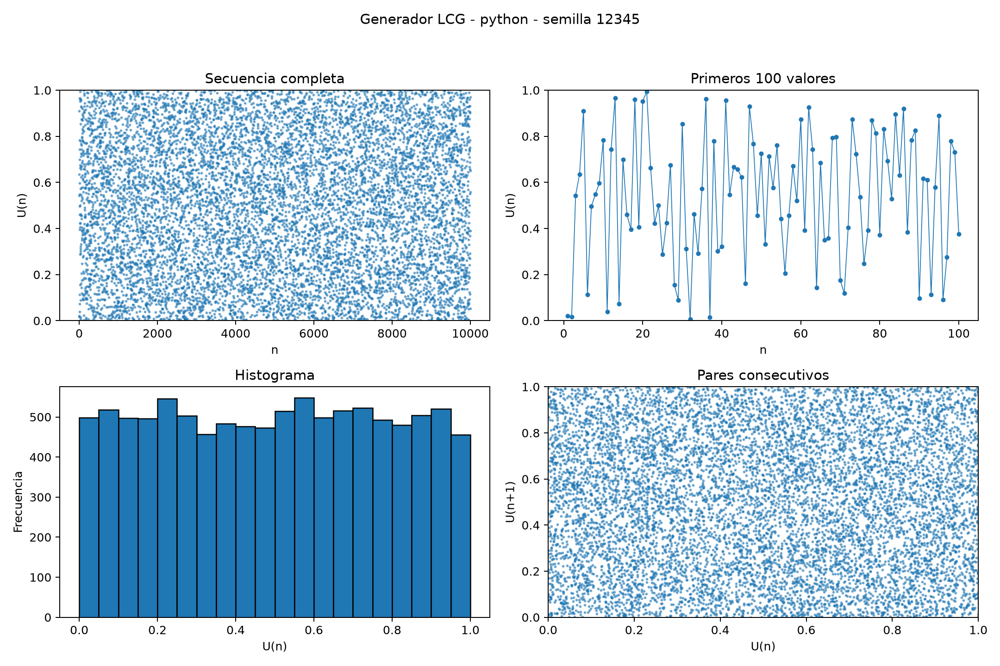
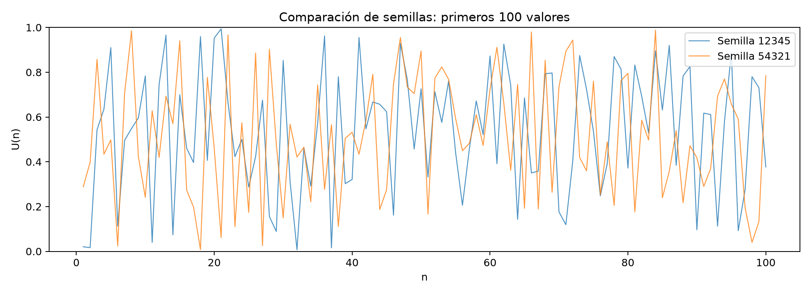

# Práctica 05: Generador Congruencial Lineal en Python y Java

Implementación y análisis del **Generador Congruencial Lineal (LCG)** en dos lenguajes. El proyecto genera secuencias reproducibles, normaliza los valores, compara los resultados de Python y Java, exporta tablas CSV y crea gráficas para su análisis.

Proyecto académico de **Simulación**, ciclo 5, Universidad Nacional de Loja. Corresponde a la unidad de generación de números pseudoaleatorios y variables aleatorias, según la guía de la práctica 05.

## Contenido

1. [Descripción del proyecto](#1-descripción-del-proyecto)
2. [Tecnologías y requisitos](#2-tecnologías-y-requisitos)
3. [Instalación](#3-instalación)
4. [Configuración](#4-configuración)
5. [Uso y resultados](#5-uso-y-resultados)
6. [Estructura y arquitectura](#6-estructura-y-arquitectura)
7. [Información adicional](#7-información-adicional)

## 1. Descripción del proyecto

### Propósito

Comprender cómo un algoritmo determinista puede producir valores que aparentan aleatoriedad y comprobar que el mismo procedimiento matemático produce resultados idénticos en Python y Java cuando se utilizan los mismos parámetros y la misma semilla.

### Funcionalidades

- Generación de 10 000 valores por lenguaje y por semilla.
- Normalización de los enteros generados al intervalo `[0, 1)`.
- Ejecución con las semillas `12345` y `54321`.
- Presentación de las primeras 20 observaciones para comparar ambos lenguajes.
- Verificación de las 10 000 observaciones de cada par de archivos.
- Exportación de secuencias y comparaciones a CSV.
- Cálculo de media, mínimo y máximo de los valores normalizados.
- Detección de estados repetidos en los pasos evaluados, incluyendo el estado inicial.
- Análisis del período teórico para módulos que sean potencias de dos mayores o iguales a cuatro.
- Gráficas de las secuencias, histogramas, pares consecutivos y comparación de semillas.
- Comprobación de reproducibilidad al volver a generar con la misma semilla.

### Modelo matemático

El generador utiliza la recurrencia:

```text
X(n+1) = (a × X(n) + c) mod m
U(n)   = X(n) / m
```

| Símbolo | Significado |
|---|---|
| `X(0)` | Semilla o estado inicial. |
| `X(n)` | Estado entero del generador. |
| `a` | Multiplicador. |
| `c` | Incremento. |
| `m` | Módulo, que determina los estados posibles. |
| `U(n)` | Valor normalizado, mayor o igual que cero y menor que uno. |

La semilla corresponde a `X(0)` y no se exporta como una observación generada. La primera fila de datos contiene `X(1)`, obtenido después de aplicar la recurrencia una vez.

## 2. Tecnologías y requisitos

| Tecnología | Uso |
|---|---|
| Python 3.9 o superior | Generación, análisis, comparación de CSV y coordinación de las gráficas. |
| JDK 11 o superior | Compilación y ejecución de la implementación Java. |
| Matplotlib | Creación y exportación de gráficas PNG. |
| Biblioteca estándar de Python | Manejo de rutas, CSV, parámetros y estadísticas básicas. |
| Biblioteca estándar de Java | Manejo de archivos, colecciones y operaciones aritméticas verificadas. |
| Linux | Entorno utilizado en las instrucciones de ejecución. |
| VS Code | Editor opcional para trabajar con ambos lenguajes. |

La versión de Matplotlib instalada debe ser compatible con la versión de Python utilizada. El archivo `requirements.txt` declara la dependencia sin fijar una versión.

Java no requiere dependencias externas. Es necesario disponer del **JDK**, que incluye `javac`; tener únicamente un entorno de ejecución Java no basta para compilar.

Puedes comprobar las herramientas con:

```bash
python3 --version
java -version
javac -version
```

## 3. Instalación

### Usar el entorno virtual compartido existente

Las instrucciones asumen esta organización:

```text
practica_simulacion/
├── venv/
└── Practica_5/
    ├── README.md
    ├── python/
    └── java/
```

Desde la carpeta `practica_simulacion`:

```bash
source venv/bin/activate
cd Practica_5
python -m pip install -r python/requirements.txt
```

Si la terminal ya está dentro de `Practica_5`, activa el mismo entorno mediante:

```bash
source ../venv/bin/activate
python -m pip install -r python/requirements.txt
```

No necesitas crear otro entorno virtual. El entorno compartido se utiliza para Python; Java se compila y ejecuta de forma independiente.

### Alternativa para una instalación independiente

Solo si no dispones de un entorno virtual, desde `Practica_5` puedes crear uno local:

```bash
python3 -m venv .venv
source .venv/bin/activate
python -m pip install -r python/requirements.txt
```

El contenido de `python/requirements.txt` es:

```text
matplotlib
```

## 4. Configuración

### Parámetros del experimento

| Parámetro | Valor |
|---|---:|
| Multiplicador `a` | 1664525 |
| Incremento `c` | 1013904223 |
| Módulo `m` | 4294967296 = 2³² |
| Cantidad por semilla y lenguaje | 10000 |
| Semilla principal de la guía | 12345 |
| Segunda semilla del experimento | 54321 |

La segunda semilla se eligió para cumplir la actividad de cambiar la semilla y comparar los resultados; la guía no establece un valor concreto para ese segundo experimento.

Los parámetros se definen en:

- `python/main.py`: constantes `A`, `C`, `M`, `CANTIDAD` y `SEMILLAS`.
- `java/src/practica/Main.java`: constantes con los mismos nombres.

Para realizar una comparación válida después de modificar el experimento, actualiza los parámetros en **ambos archivos**, recompila Java y vuelve a ejecutar ambos programas.

En Python, `2**32` expresa la potencia. En Java se utiliza `1L << 32`; el operador `^` de Java representa XOR y no potenciación.

### Validaciones

Los modelos comprueban que:

- `m > 1`.
- `0 <= a < m`.
- `0 <= c < m`.
- `0 <= semilla < m`.
- La cantidad de valores sea positiva.

Python también valida que los parámetros sean enteros. Java utiliza `long` para almacenar los estados y parámetros, y verifica las multiplicaciones y sumas con `Math.multiplyExact` y `Math.addExact`. Los parámetros de la guía caben en `long`; otras configuraciones podrían provocar una excepción por desbordamiento.

## 5. Uso y resultados

Ejecuta los siguientes comandos desde la carpeta `Practica_5`, con el entorno virtual de Python activado.

### Paso 1. Compilar Java

```bash
javac -encoding UTF-8 -d java/bin java/src/practica/modelo/GeneradorLCG.java java/src/practica/servicio/ServicioLCG.java java/src/practica/Main.java
```

Si la compilación es correcta, el comando termina sin mensajes de error. Los archivos compilados se guardan en `java/bin`.

### Paso 2. Ejecutar Java

```bash
java -cp java/bin practica.Main resultados/java
```

Java muestra las primeras 20 observaciones y el análisis para cada semilla. También genera los archivos CSV que posteriormente leerá Python.

### Paso 3. Ejecutar Python

```bash
python python/main.py
```

Python genera sus propias secuencias, analiza los datos, compara los archivos de ambos lenguajes y guarda las gráficas.

Si se ejecuta Python antes que Java, se generan los resultados propios y se informa que faltan los CSV de Java. Para completar la comparación, ejecuta Java y después vuelve a ejecutar Python.

### Paso 4. Consultar los archivos

Desde un escritorio Linux puedes abrir las carpetas con:

```bash
xdg-open resultados/graficas
xdg-open resultados/comparaciones
```

Las gráficas se guardan como imágenes; el programa no abre ventanas de Matplotlib automáticamente.

### Archivos generados

| Ubicación | Contenido |
|---|---|
| `resultados/python/lcg_12345.csv` | Secuencia Python con semilla 12345. |
| `resultados/python/lcg_54321.csv` | Secuencia Python con semilla 54321. |
| `resultados/java/lcg_12345.csv` | Secuencia Java con semilla 12345. |
| `resultados/java/lcg_54321.csv` | Secuencia Java con semilla 54321. |
| `resultados/comparaciones/comparacion_12345.csv` | Comparación de los 10 000 resultados de ambos lenguajes. |
| `resultados/comparaciones/comparacion_54321.csv` | Comparación de los 10 000 resultados de ambos lenguajes. |
| `resultados/graficas/python_12345.png` | Panel de gráficas de Python, semilla 12345. |
| `resultados/graficas/python_54321.png` | Panel de gráficas de Python, semilla 54321. |
| `resultados/graficas/java_12345.png` | Panel de los datos generados por Java, semilla 12345. |
| `resultados/graficas/java_54321.png` | Panel de los datos generados por Java, semilla 54321. |
| `resultados/graficas/comparacion_semillas.png` | Comparación de los primeros 100 valores de las dos semillas. |

Cada nueva ejecución sobrescribe los archivos de las semillas que procesa. Si modificas las semillas, pueden permanecer archivos de experimentos anteriores; comprueba sus nombres antes de utilizarlos en el informe.

### Formato de las tablas

Las secuencias utilizan estas columnas:

```csv
n,x,u
```

Las tablas comparativas utilizan:

```csv
n,x_python,x_java,u_python,u_java,coinciden
```

La comparación verifica el índice, el estado entero y el valor normalizado. Para estos parámetros, la normalización entre una potencia de dos es representable exactamente en los tipos de punto flotante utilizados. Los CSV conservan la precisión de los valores; la consola muestra diez decimales como formato de presentación.

### Resultados registrados

En la ejecución registrada de esta práctica se obtuvo:

| Semilla | Media de U | Mínimo de U | Máximo de U | Coincidencias Python–Java |
|---|---:|---:|---:|---:|
| 12345 | 0.4987698480 | 0.0000590826 | 0.9999259654 | 10000/10000 |
| 54321 | 0.4988696998 | 0.0000783911 | 0.9998461837 | 10000/10000 |

Para cada semilla, la salida confirmó:

```text
Comparación completa: 10000/10000 observaciones iguales.
```

Los primeros cinco estados permiten comprobar rápidamente la implementación:

| n | X(n), semilla 12345 | X(n), semilla 54321 |
|---:|---:|---:|
| 1 | 87628868 | 1238253532 |
| 2 | 71072467 | 1708513675 |
| 3 | 2332836374 | 3683344750 |
| 4 | 2726892157 | 1863498229 |
| 5 | 3908547000 | 2137457360 |

No se detectaron estados repetidos en los pasos evaluados de cada ejecución. Entre las dos semillas se obtuvieron `0/10000` coincidencias al comparar valores en la misma posición. Esto no demuestra que las secuencias sean estadísticamente independientes.

### Gráficas

Cada panel contiene:

1. La secuencia completa de 10 000 valores normalizados.
2. Los primeros 100 valores, para observar el orden de generación.
3. Un histograma de 20 intervalos.
4. Los pares consecutivos `U(n)` y `U(n+1)`.

Los resultados exportados por Java también se grafican con Python. La generación numérica sí se implementa de manera independiente en ambos lenguajes.

Después de ejecutar el proyecto, las siguientes imágenes estarán disponibles:





Si los datos de Python y Java coinciden, sus paneles para una misma semilla deben representar los mismos puntos y frecuencias.

## 6. Estructura y arquitectura

```text
Practica_5/
├── README.md
├── python/
│   ├── modelo.py
│   ├── servicios.py
│   ├── graficas.py
│   ├── main.py
│   └── requirements.txt
├── java/
│   ├── src/
│   │   └── practica/
│   │       ├── modelo/
│   │       │   └── GeneradorLCG.java
│   │       ├── servicio/
│   │       │   └── ServicioLCG.java
│   │       └── Main.java
│   └── bin/                         # Generada al compilar.
└── resultados/                      # Generada al ejecutar.
    ├── python/
    ├── java/
    ├── comparaciones/
    └── graficas/
```

El proyecto utiliza una **arquitectura por capas con separación de responsabilidades**. La implementación entregada no corresponde a un MVC estricto: no contiene una capa de controlador independiente ni una vista Java separada del servicio de consola.

| Archivo | Responsabilidad |
|---|---|
| `python/modelo.py` | Define `ParametrosLCG`, valida los parámetros e implementa `GeneradorLCG`. |
| `python/servicios.py` | Lee y escribe CSV, calcula estadísticas, analiza repeticiones y período, y compara ambos lenguajes. |
| `python/graficas.py` | Crea los paneles y la comparación visual de semillas. |
| `python/main.py` | Define parámetros y coordina generación, exportación, análisis y comparación. |
| `python/requirements.txt` | Declara la dependencia externa de Python. |
| `java/src/practica/modelo/GeneradorLCG.java` | Valida parámetros y genera estados mediante la recurrencia LCG. |
| `java/src/practica/servicio/ServicioLCG.java` | Exporta CSV, presenta observaciones y calcula el análisis. |
| `java/src/practica/Main.java` | Configura y coordina los experimentos Java. |

Los generadores no utilizan `random` ni `java.util.Random`: la recurrencia se implementa directamente. Los dos programas intercambian resultados mediante archivos CSV; no requieren una integración directa entre sus procesos.

## 7. Información adicional

### Análisis del período

El período es la longitud del ciclo de estados que se repite. Para un módulo `m = 2^k`, con `k >= 2`, el teorema de Hull–Dobell garantiza período completo cuando:

- `c` es impar.
- `a - 1` es divisible por cuatro.

En esta configuración:

```text
c     = 1013904223              → impar
a - 1 = 1664524 = 4 × 416131   → divisible por 4
m     = 2^32 = 4294967296
```

Por tanto, el período teórico es **4294967296 estados**, para cualquier semilla válida.

Este resultado es teórico. Generar 10 000 valores sin repeticiones no permite medir experimentalmente un ciclo de más de cuatro mil millones de estados. El programa distingue la observación de la muestra del análisis matemático.

### Interpretación y limitaciones

- La igualdad entre lenguajes confirma la consistencia de las implementaciones para los experimentos ejecutados.
- Reutilizar los mismos parámetros y semilla reproduce la misma secuencia.
- Cambiar la semilla modifica el punto inicial de la secuencia. Con período completo, las semillas pertenecen al mismo ciclo de estados y representan diferentes posiciones de ese ciclo.
- Las medias registradas son cercanas a `0.5`, pero ese hecho aislado no demuestra uniformidad.
- Los histogramas y diagramas de pares son herramientas exploratorias; no sustituyen pruebas estadísticas de uniformidad e independencia.
- Un período largo no garantiza por sí solo buena calidad estadística.
- Este proyecto tiene finalidad educativa y no está destinado a generar contraseñas, claves ni otros valores criptográficos.

### Preguntas de control

**¿Qué significa pseudoaleatorio?**

Describe valores producidos por un algoritmo determinista que aparentan aleatoriedad. Con los mismos parámetros y estado inicial, los resultados se repiten.

**¿Qué función cumple la semilla?**

Define el estado inicial `X(0)` y permite reproducir el experimento.

**¿Qué significa período?**

Es el número de estados del ciclo antes de que la secuencia vuelva a repetirse.

**¿Qué ocurre si se utilizan parámetros inadecuados?**

Pueden producirse ciclos cortos, patrones o una cobertura deficiente de los estados posibles, afectando la utilidad de los números para una simulación.

**¿Qué ventaja tiene implementar el mismo algoritmo en dos lenguajes?**

Permite contrastar resultados y detectar diferencias debidas a la implementación, los tipos de datos o las operaciones aritméticas.

### Solución de problemas

| Mensaje o situación | Acción |
|---|---|
| No se encuentra `python/requirements.txt` | Ejecutar desde `Practica_5` y comprobar que el archivo exista con ese nombre. Linux distingue mayúsculas y minúsculas. |
| `file not found: ...ServicioLCG.java` | Comprobar la ruta `java/src/practica/servicio/ServicioLCG.java` y el nombre del archivo. |
| `javac: command not found` | Instalar o configurar un JDK que incluya el compilador. |
| `ModuleNotFoundError: No module named 'matplotlib'` | Activar el entorno correcto e instalar las dependencias con `python -m pip install -r python/requirements.txt`. |
| Falta el CSV de Java | Ejecutar Java antes de repetir la ejecución de Python. |
| Se encuentran diferencias entre lenguajes | Revisar parámetros, cantidad, semillas, convención de `X(0)` y recompilar Java. Regenerar los archivos de ambos lenguajes. |
| No aparecen ventanas de gráficas | Abrir las imágenes de `resultados/graficas`; se guardan sin abrir ventanas. |

`Requirement already satisfied` indica que una dependencia ya está instalada en el entorno utilizado. No es un error.

### Validación realizada

La salida de ejecución registrada muestra compilación y ejecución de Java, ejecución de Python, generación de archivos y coincidencia completa para ambas semillas. El código también comprueba reproducibilidad durante la ejecución. La estructura presentada no incluye una suite separada de pruebas automatizadas.

### Entrega académica

Para documentar la práctica, utilizar las primeras 20 filas de cada tabla comparativa, las gráficas, el análisis del período, la comparación de semillas y las conclusiones propias. La guía también solicita responder las preguntas de control.

### Contribuciones y licencia

Al modificar el proyecto, conservar la separación de responsabilidades y volver a verificar las secuencias de ambos lenguajes. No incluir entornos virtuales, cachés de Python ni archivos compilados como código fuente.

No se ha especificado una licencia de distribución para este proyecto.

### Referencias

- Guía de Actividades Práctico-Experimentales: práctica 05, «Implementación y análisis del Generador Congruencial Lineal en Python y Java», asignatura Simulación, 29 y 30 de octubre de 2026.
- Diapositivas de la semana 5 indicadas en la bibliografía de la guía.
- [LCGs — MATH5835M Statistical Computing](https://mpaldridge.github.io/math5835/lectures/L11-lcg.html): condiciones de período completo y limitaciones del generador.
